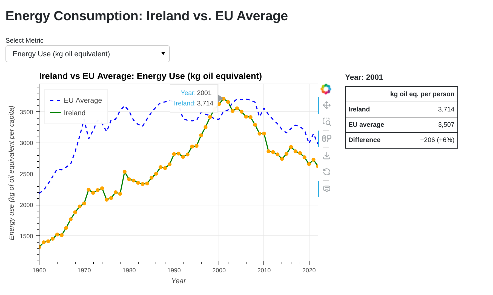
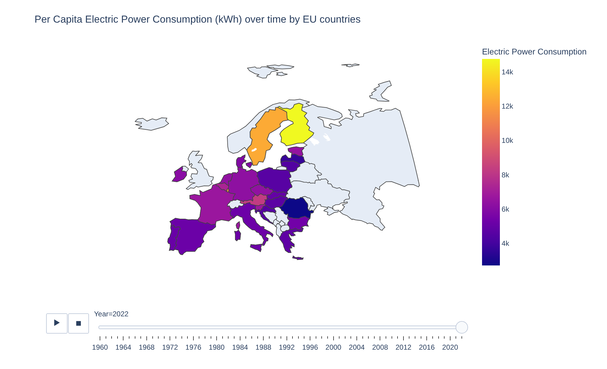
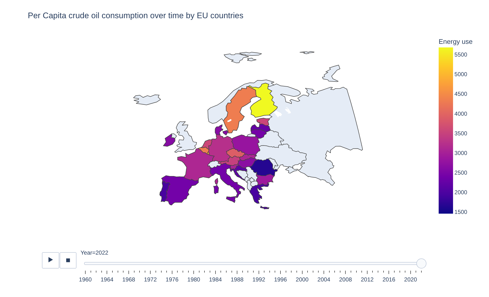
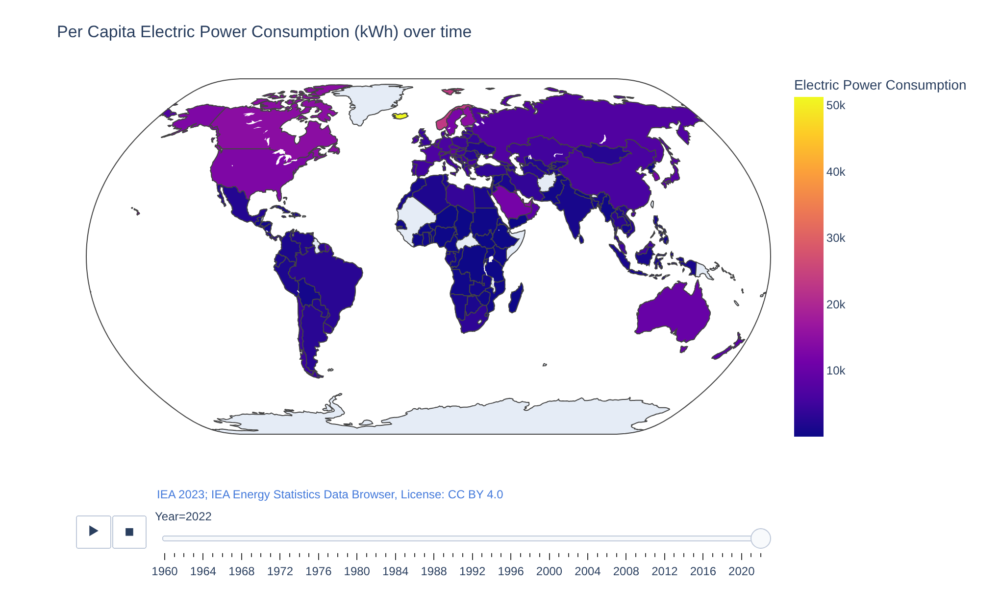
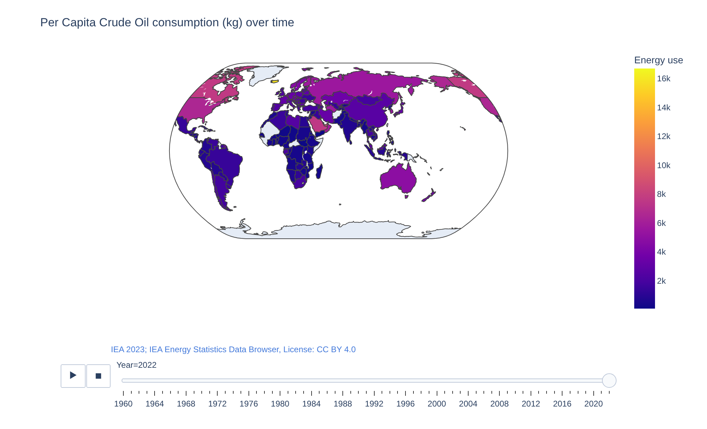
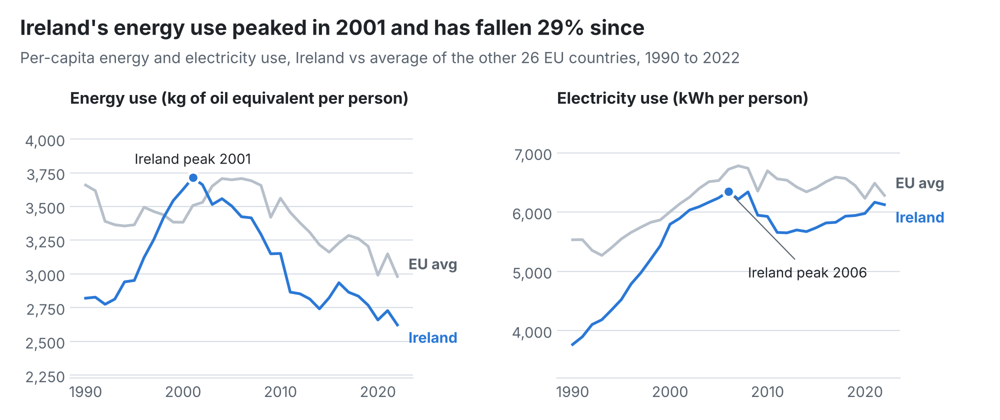
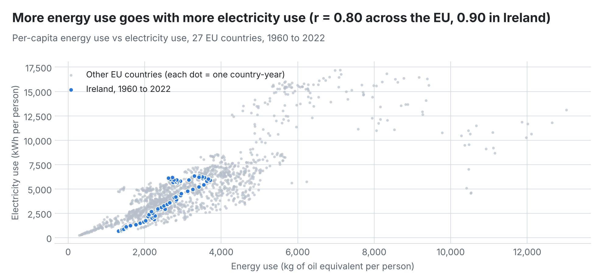
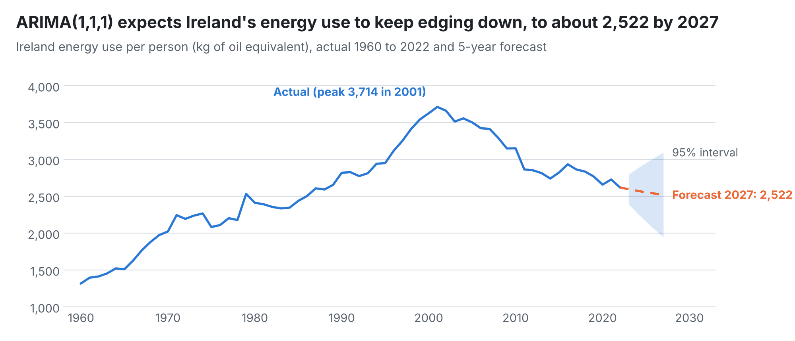
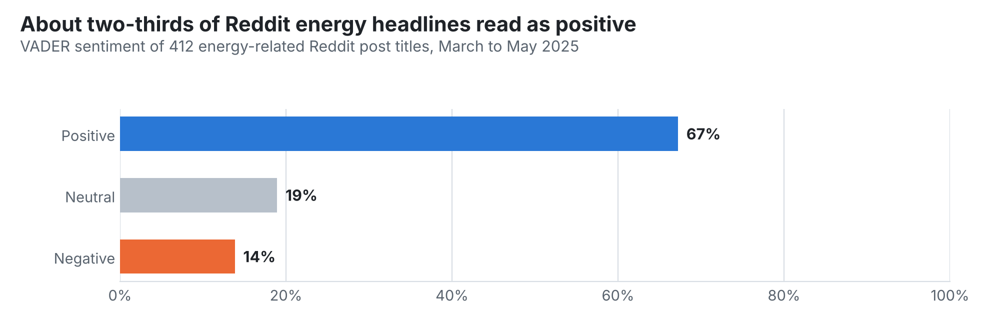

<div align="center">

# ⚡ Ireland vs EU Energy Consumption Forecasting

### How energy and electricity use evolved across the EU, what drives electricity demand, and where Ireland is heading


[**Demo**](#-dashboard-demo) · [**Key insights**](#-key-insights) · [**Models**](#-models) · [**Run the dashboard**](#-run-it-yourself) · [**Data**](#-data-sources)

</div>

---

## 📌 At a glance

| 🌍 Coverage | 🇮🇪 Ireland's energy use since its 2001 peak | 🔗 Energy vs electricity link | 🤖 Best electricity model (Ireland) | 💬 Reddit headlines analysed |
|:---:|:---:|:---:|:---:|:---:|
| **27 EU countries, 1960 to 2022** | **down 29%** | **r = 0.80** (EU), **0.90** (Ireland) | **R² 0.88 to 0.89** | **412** |

I combined two World Bank indicators (per-capita **energy use**, which the project uses as a proxy for crude oil consumption, and per-capita **electricity use**) for all 27 EU countries, then:

1. Built **interactive dashboards in Panel and Plotly** to compare Ireland with the EU over six decades
2. Used **XGBoost and Random Forest** to test whether energy use explains electricity use
3. Forecast Ireland's energy use with **ARIMA**
4. Analysed public sentiment in **412 energy-related Reddit headlines** with VADER, k-means clustering and a Naive Bayes classifier

---

## 🎬 Dashboard demo

<!--
  To make the video play: on github.com edit this README, delete the line below that
  starts with https://github.com/user-attachments, and drag docs/dashboard-demo.mp4
  from your computer onto that empty line. GitHub uploads it and inserts a playable
  video. You can then delete the GIF line underneath and this comment.
-->


<sub>The Panel dashboard running live (hover to compare any year, switch between energy and electricity), followed by the animated Plotly maps for the EU and the world.</sub>

## 📊 Interactive dashboards

**Panel dashboard: Ireland vs EU average.** Pick a metric, then hover over any year to see Ireland, the EU average and the gap between them.



**Animated Plotly maps: six decades of EU energy use.** Press play to watch each country's per-capita consumption change from 1960 to 2022.

| Electricity use per person, 2022 | Energy use per person, 2022 |
|---|---|
|  |  |

**Animated Plotly world maps: putting the EU in a global context.** The same two measures for every country with World Bank data, on a natural-earth projection.

| Electricity use per person, 2022 | Energy use per person, 2022 |
|---|---|
|  |  |

<sub>Open `Dashboard_1.html`, `Dashboard_2.html`, `World_Electricity.html` and `World_Energy.html` in a browser for the animated maps, and run `panel serve dashboard_app.py` for the live Panel dashboard.</sub>

---

## 💡 Key insights

### 1. Ireland's energy use peaked in 2001 and has fallen faster than the EU's

<picture>
  <source media="(prefers-color-scheme: dark)" srcset="docs/charts/ireland-vs-eu-trends-dark.png">
  
</picture>

- Ireland's energy use rose almost **3x from 1960 to its 2001 peak** (1,319 to 3,714 kg of oil equivalent per person), then fell **29% to 2,622 by 2022**, now **12% below the EU average** (2,982).
- **Electricity use behaves differently.** It peaked in 2006 (6,351 kWh) and has stayed close to that level (6,126 kWh in 2022), just under the EU average (6,283 kWh). Ireland is cutting overall energy use without cutting electricity use, which is consistent with a shift towards electrification.

### 2. Energy use and electricity use move together

<picture>
  <source media="(prefers-color-scheme: dark)" srcset="docs/charts/energy-vs-electricity-dark.png">
  
</picture>

- Across all EU country-years the correlation is **0.80**, and within Ireland it is **0.90**. That supports the research question that energy (crude oil) use is a strong signal for electricity demand.
- The relationship is not a straight line: countries such as Sweden and Finland use far more electricity for a similar level of energy use. That non-linearity, plus skewed distributions, is why I chose tree-based models over linear regression.

### 3. ARIMA expects a slow, continued decline

<picture>
  <source media="(prefers-color-scheme: dark)" srcset="docs/charts/arima-forecast-dark.png">
  
</picture>

- The **ARIMA(1,1,1)** model forecasts Ireland's energy use falling from **2,597 in 2023 to 2,522 kg per person by 2027**.
- The 95% interval widens to **1,948 to 3,097 by 2027**, so the forecast shows the direction of travel rather than a precise figure.

### 4. Public conversation about energy is mostly positive

<picture>
  <source media="(prefers-color-scheme: dark)" srcset="docs/charts/reddit-sentiment-dark.png">
  
</picture>

- About **two-thirds of 412 Reddit energy headlines** (March to May 2025) read as positive, with an average VADER compound score of **0.26**.

---

## 🤖 Models

### Does energy use predict electricity use? (XGBoost vs Random Forest)

Both models were tuned with `GridSearchCV`. Results are taken from the notebook outputs.

| Data | Model | Cross-validated R² | Test R² | Test RMSE (kWh) |
|---|---|:---:|:---:|:---:|
| **EU, 27 countries** | XGBoost | 0.79 | **0.81** | 1,535 |
| | Random Forest | 0.79 | 0.80 | 1,571 |
| **Ireland only** (63 years) | XGBoost | 0.74 | 0.88 | 722 |
| | Random Forest | 0.71 | **0.89** | 681 |

**In plain terms:** energy use alone explains around 80% of the variation in electricity use across the EU, and close to 90% within Ireland.

**Caveat:** before tuning, 10-fold cross-validation on the EU data was unstable (mean R² 0.27, with 3 of 10 folds negative), and Ireland's test set is only about 13 years. With a single input feature and small samples, the tuned scores should be read as indicative.

### Forecasting energy use (ARIMA)

- **Stationarity:** the Augmented Dickey-Fuller test showed the raw series was non-stationary (p = 0.25). After first differencing it became stationary (p = 0.04), so d = 1.
- **Model choice:** I fitted ARIMA(1,1,1), with both terms significant (p < 0.001). A grid search over p and q up to 2 found ARIMA(2,1,2) has a slightly lower AIC (748 vs 754).

### Text analytics (Reddit, via PRAW)

| Step | Method | Result |
|---|---|---|
| Sentiment scoring | VADER compound score | About 67% positive, 19% neutral, 14% negative |
| Sentiment and posting-time clusters | k-means on sentiment score, hour and TF-IDF features | Silhouette score **0.52** |
| Sentiment classification | Bag of Words + Multinomial Naive Bayes | **62% accuracy** across 3 classes; strongest on positive headlines |

---

## ✅ Takeaways

1. **Energy use is a strong early signal for electricity demand.** Planners can use energy-use trends, which are published widely, to anticipate electricity needs.
2. **Ireland is decoupling energy use from electricity use.** Total energy use is falling while electricity holds steady, which is consistent with a move towards electrification and greater efficiency.
3. **Expect gradual, not sudden, change.** The ARIMA forecast points to a slow decline, so policy targets that assume rapid drops will need extra measures.
4. **Public sentiment can complement hard data.** A mostly positive online conversation about energy suggests goodwill that policy communications can build on.

---

## 🛠 Tools and methods

| Area | What I did |
|---|---|
| **Data collection** | World Bank data via API with a CSV fallback; Reddit headlines via PRAW; timed and profiled the collection code |
| **Data preparation** (pandas) | Merged four World Bank files (1960 to 2015 and 2015 to 2024), reshaped wide to long, fixed data types, handled missing values with median imputation |
| **Statistics** | Descriptive statistics, IQR outlier checks, distribution analysis for Ireland and France |
| **Machine learning** (scikit-learn, XGBoost) | Random Forest and XGBoost regression, 5- and 10-fold cross-validation, GridSearchCV tuning |
| **Time series** (statsmodels) | ADF tests, differencing, ACF/PACF, ARIMA fitting, residual checks and 5-year forecast |
| **NLP** (VADER, scikit-learn) | Text cleaning, VADER sentiment, TF-IDF, k-means clustering, Multinomial Naive Bayes |
| **Dashboards** (Panel, HoloViews, Plotly) | Interactive Ireland vs EU dashboard with linked hover table; animated choropleth maps for the EU and the world |

---

## 📁 Repository structure

```
├── CA2_WIN_Part1.ipynb              # Data collection, cleaning, EDA and the Panel dashboard
├── CA2_Win_Part2.ipynb              # Descriptive statistics and Ireland vs France comparison
├── CA2_Win_Part3.ipynb              # Machine learning, ARIMA forecasting and sentiment analysis
├── dashboard_app.py                 # Live Panel dashboard (run with `panel serve`)
├── Dashboard_1.html                 # Animated map: electricity use per person
├── Dashboard_2.html                 # Animated map: energy use per person
├── World_Electricity.html           # Animated world map: electricity use per person
├── World_Energy.html                # Animated world map: energy use per person
├── Dashboard_3.html                 # Static export of the original Panel dashboard
├── merged.csv / eu_merged (1).csv   # Cleaned World Bank data (all countries / EU 27)
├── energy_posts.csv                 # 412 Reddit energy headlines
├── *_Data*.csv, WB_WDI_*.csv        # Raw World Bank downloads
└── docs/
    ├── make_charts.py               # Rebuilds the README charts and prints all figures
    ├── record_demo.py               # Records the dashboard demo video
    ├── dashboard-demo.mp4 / .gif    # Dashboard demo
    ├── charts/                      # README charts (light and dark versions)
    └── screenshots/                 # Dashboard screenshots
```

## 🚀 Run it yourself

```bash
pip install pandas numpy matplotlib seaborn scikit-learn xgboost statsmodels vaderSentiment nltk panel holoviews bokeh plotly

panel serve dashboard_app.py --show     # live Panel dashboard
jupyter notebook                        # open the three CA2 notebooks
python docs/make_charts.py              # rebuild the README charts and figures
```

---

## 🔭 Next steps

- Add renewable energy share as a second predictor, to separate electrification from overall demand
- Validate the forecasts on held-out recent years (train to 2017, test 2018 to 2022)
- Replace VADER with a transformer model (for example BERT) for more nuanced sentiment
- Deploy the Panel dashboard online so it can be explored without installing Python

## 📚 Data sources

- **Electricity use per person (kWh):** World Bank, [EG.USE.ELEC.KH.PC](https://data.worldbank.org/indicator/EG.USE.ELEC.KH.PC) and [WB_WDI_EG_USE_ELEC_KH_PC](https://data360.worldbank.org/en/indicator/WB_WDI_EG_USE_ELEC_KH_PC)
- **Energy use per person (kg of oil equivalent):** World Bank, [EG.USE.PCAP.KG.OE](https://databank.worldbank.org/source/world-development-indicators/Series/EG.USE.PCAP.KG.OE) and [WB_WDI_EG_USE_PCAP_KG_OE](https://data360.worldbank.org/en/indicator/WB_WDI_EG_USE_PCAP_KG_OE)
- **Public sentiment:** energy-related Reddit post titles collected with the Reddit API (PRAW), March to May 2025
